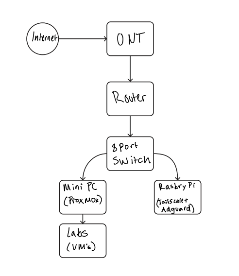
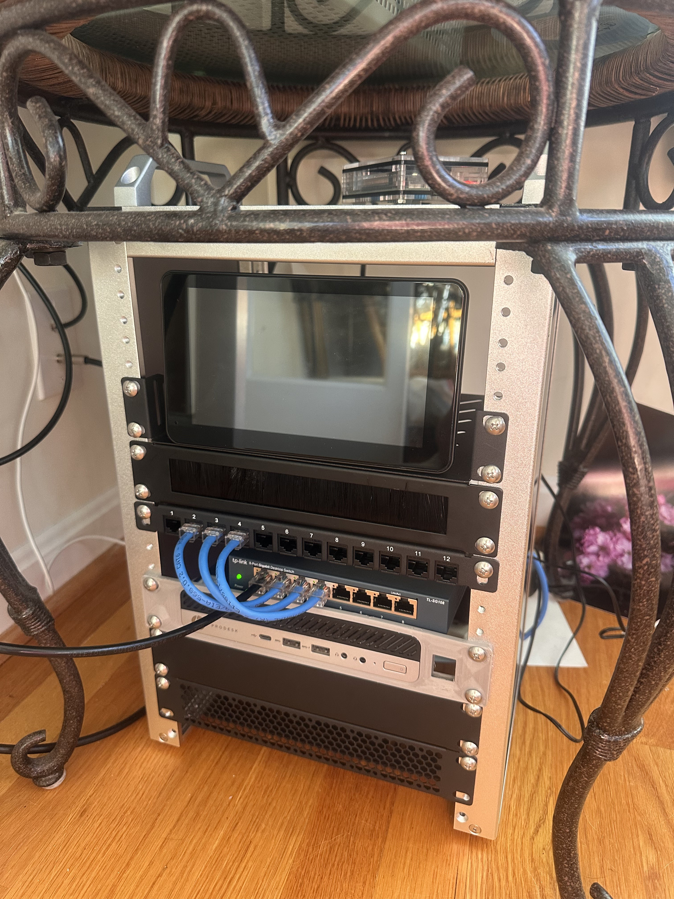

# Homelab

My home network and server setup. I'm using it to run labs and learn networking and infrastructure hands on. Everything here, from the cabling to the Isolated VMs, I set up myself.

## Network layout

## Hardware

| Device | Specs | Role |
| --- | --- | --- |
| HP ProDesk 600 G4 Mini | i5-8500T, 16 GB RAM, 256 GB SSD | Proxmox host for VMs |
| Raspberry Pi 3B+ | | Tailscale remote access & AdGuard Home DNS ad blocking |
| TP-Link TL-SG108 | 8-port gigabit, unmanaged | Connects everything in the rack |
| Patch panel | Pass-through | Keeps the rack cabling organized |

## Cabling

The router used to be on the top floor with a WiFi extender in the basement running through MoCA. The room I wanted the lab in had no Ethernet, so I ran new Cat6 and Coax lines through the house to the new room. Now the router, switch, and servers all sit together in one spot. I learned how to terminate the RJ45 ends, and to check every run with a cable tester, even the small patch cables in the rack.

## What's running right now

| Service | Where | What it does |
| --- | --- | --- |
| Proxmox VE | ProDesk | Runs isolated VMs for labs |
| routing-lab | Proxmox VM | Four router OSPF/BGP lab, see [routing-lab](https://github.com/michqelbush/routing-lab) |
| Tailscale | Raspberry Pi | Remote access to the homelab without opening ports |
| AdGuard Home | Raspberry Pi | DNS level ad and tracker blocking |

## Why?

I wanted a place to run labs, and do other things like ad blocking, at all times, not just when my PC was on. Keeping the Pi separate from the Proxmox box means remote access and DNS stay up even when I'm rebuilding VMs.

## What's next

- Get the screen I have running a monitoring dashboard
- Different labs for new things I want to learn about
- Connect the routing-lab to AWS with a site to site VPN over BGP
- Self hosted media libraries 

&nbsp;
